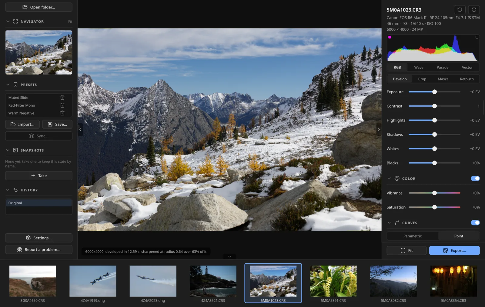

# greycard

A professional raw photo editor with accurate color, for Linux, macOS
and Windows. Fast, and open source.

I took my favorite parts of every editor I know and built the one I
wanted to use. I'm a software engineer and a
[photographer](https://jessolmstead.com), and greycard is already the
editor I use for my own work. It's still early, and there's a lot more
on the [roadmap](docs/roadmap.md). I'm not going to stop until it's a
complete, battle-tested editor.

**[Download](https://github.com/jessolmstead/greycard/releases/latest)** ·
[User guide](docs/user-guide.md) ·
[greycard.org](https://greycard.org)

## Highlights

- **Camera color match.** Give it a varied set of frames from your
  camera and it learns the camera's own JPEG look, such as Canon
  Standard or Fujifilm Provia, as a look you can pick.
  [How well it fits](docs/camera-match.md).
- **Masks that do more.** Absolute white balance on a mask makes mixed
  light easy, and the color mixer works inside a mask.
- **Scopes for the mask:** parade, waveform and vectorscope, which you
  can limit to the masked area to get skin tones right.
- **AI denoising on the raw sensor data.** I trained the model myself,
  and it works a treat on Canon, Fujifilm GFX, Nikon, Sony and
  Panasonic.
- **Your folders are the truth.** Edits live in a sidecar beside each
  raw. The library index makes finding and filtering fast without
  owning your photos.
- **Works across machines.** Cull a shoot on a NAS from local
  previews, and keep an archive drive in step with your edits.
- **Local AI masks** for subjects, objects, skies and people, down to
  eyes, lips, hair and clothing. All on your machine.
- **Quick culling** from the camera's embedded previews, so getting
  through a shoot is smooth.
- **Fast and familiar.** Native Rust, Slint and the GPU, so sliders
  update as you drag. The layout will feel at home if you're coming
  from Lightroom Classic. Lightroom presets load, and a Lightroom
  catalog comes across with its ratings, edits and collections.
- **The best open source algorithms.** greycard is GPL, so parts of the
  pipeline come straight from darktable and RawTherapee, credited in
  each file.

## Cameras

It opens what [rawler](https://github.com/dnglab/dnglab) decodes
([camera list](https://github.com/dnglab/dnglab/blob/main/SUPPORTED_CAMERAS.md)),
and I test on Canon, Fujifilm GFX and X-Trans, Nikon, Sony and
Panasonic raws.

## Not there yet

- The learned denoiser doesn't run on Fujifilm X-Trans raws yet.
- Nikon High Efficiency raws only open in a build from source with the
  `nikon-he` feature. The format is licensed, and shipping its decoder
  means royalties. I'm working on it.
- The Mac and Windows builds aren't signed yet, so you have to click
  past a warning the first time.
- No build yet for Intel Macs or Windows on ARM.

## Install

Download your system's file from the
[releases page](https://github.com/jessolmstead/greycard/releases/latest)
and unpack it.

- **Linux:** `sh install.sh`
- **macOS:** `sh install.sh` (Apple silicon, macOS 13.4 or newer).
  [Step by step](docs/testing-on-a-mac.md).
- **Windows:** double-click `install.cmd`. `register.cmd` adds
  greycard to Open with for raws.

You'll need a GPU with Vulkan, or Metal on a Mac.
[Building from source](docs/building.md) is a `cargo build --release`
once the libraries are in, and one script for the AI runtime.

## Feedback

Bugs, feature requests, things you love or hate: please tell me. Use
**Report a problem...** at the bottom of the left panel, or
[open an issue](https://github.com/jessolmstead/greycard/issues/new/choose).
A raw that renders wrong, with the camera model, is the most useful
thing you can send.

## More

- [User guide](docs/user-guide.md)
- [Where greycard fits](docs/where-greycard-fits.md) next to Lightroom,
  Capture One, darktable, RawTherapee and others
- [Changelog](docs/changelog.md)
- [Design notes](docs/notes.md)

GPL-3.0-or-later.
