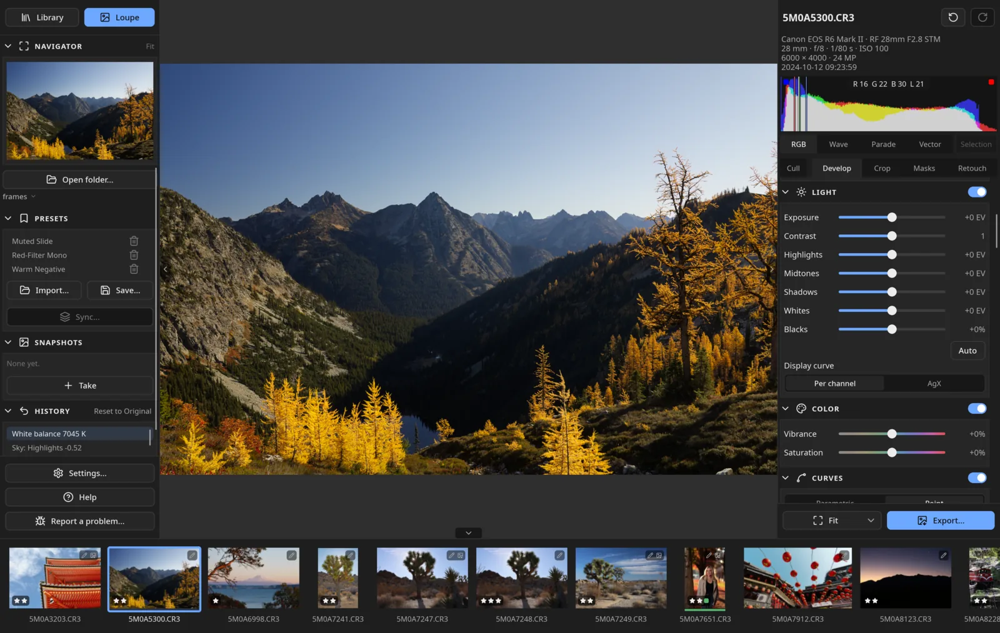

# greycard

A professional raw photo editor with accurate color, for Linux, macOS
and Windows. Fast, and open source.

I took my favorite parts of every editor I know and built the one I
wanted to use. I'm a software engineer and a
[photographer](https://jessolmstead.com), and greycard is already the
editor I use for my own work. It's still early, and there's a lot more
on the [roadmap](docs/roadmap.md). I'm not going to stop until it's a
complete, battle-tested editor.

**[Download](https://github.com/jessolmstead/greycard/releases/latest)** ·
[User guide](docs/user-guide.md) ·
[greycard.org](https://greycard.org)

## Highlights

- **Camera color match.** Give it a varied set of frames from your
  camera and it learns the camera's own JPEG look, such as Canon
  Standard or Fujifilm Provia, as a look you can pick.
  [How well it fits](docs/camera-match.md).
- **Masks that do more.** Absolute white balance on a mask makes mixed
  light easy, and the color mixer works inside a mask.
- **Scopes for the mask:** parade, waveform and vectorscope, which you
  can limit to the masked area to get skin tones right.
- **AI denoising on the raw sensor data.** I trained the model myself,
  and it works a treat on Canon, Fujifilm GFX, Nikon, Sony and
  Panasonic.
- **Your folders are the truth.** Edits live in a sidecar beside each
  raw. The library index makes finding and filtering fast without
  owning your photos.
- **Works across machines.** Cull a shoot on a NAS from local
  previews, and edit it on a laptop and a desktop: each save goes to
  the NAS's copy, and edits made on both are joined, neither lost
  ([how](docs/guide/archives.md#working-on-two-computers)).
- **Local AI masks** for subjects, objects, skies and people, down to
  eyes, lips, hair and clothing. All on your machine, and nothing
  phones home: the network is used to fetch a model or the lens
  database when you first ask for one, and for the update check you
  can turn off.
- **Quick culling** from the camera's embedded previews, so getting
  through a shoot is smooth.
- **Merges in the editor.** A bracket to HDR, frames to a panorama, a
  stack to one focus, handheld or not, each a linear DNG that edits
  as a raw.
- **Export from a script.** `greycard export IMG_0001.CR3 out.jpg`
  writes a frame under its saved edit with no window, no GPU, and no
  desktop, so it runs over SSH; give several frames and a folder for a
  set, and a preset or a long edge as flags
  ([the guide](docs/guide/export.md#from-the-command-line)).
- **Fast and familiar.** Native Rust, Slint and the GPU, demosaic
  included, so frames open quickly and sliders update as you drag. The layout will feel at home if you're coming
  from Lightroom Classic. Lightroom presets load, and a Lightroom
  catalog comes across with its ratings, edits and collections.
- **The best open source algorithms.** greycard is GPL, so parts of the
  pipeline come straight from darktable and RawTherapee, credited in
  each file.

## Cameras

It opens what [rawler](https://github.com/dnglab/dnglab) decodes
([camera list](https://github.com/dnglab/dnglab/blob/main/SUPPORTED_CAMERAS.md)),
and it's tested on Canon, Fujifilm GFX and X-Trans, Nikon, Sony,
Panasonic, and Olympus and OM System raws.

## Not there yet

- The learned denoiser doesn't run on Fujifilm X-Trans raws yet.
- Nikon High Efficiency raws only open in a build from source with the
  `nikon-he` feature. The format is licensed, and shipping its decoder
  means royalties. I'm working on it.
- The Windows installer and zip aren't signed yet, so you have to
  click past a warning the first time.
- The Intel Mac build is new, and the generative remove is not
  available on it.
- There is a Windows on ARM build and installer, though a release
  can still go out without them while they're new. Its AI features
  run on the CPU alone, through a runtime it offers to download the
  first time you use one, and I haven't run it on an ARM laptop
  myself yet.

## Install

Download your system's file from the
[releases page](https://github.com/jessolmstead/greycard/releases/latest).
Unpack it, unless it's the Windows setup, which you just run.

- **Linux:** `sh install.sh`, or take the `.AppImage` instead, make it
  executable and run it (it needs FUSE, or `--appimage-extract-and-run`).
- **macOS:** open the `.dmg` and drag greycard to Applications (Apple
  silicon or Intel, macOS 13.4 or newer); the `.tar.gz`'s `sh install.sh` also
  adds the `greycard` command. [Step by step](docs/testing-on-a-mac.md).
- **Windows:** run the `-setup.exe`, which needs no administrator.
  The `.zip` is the portable build: unpack it and run
  `bin\greycard-ui.exe`. The `aarch64-windows` files are for Windows
  on ARM.

You'll want a GPU with Vulkan, or Metal on a Mac. Without one it
still opens, drawing in software and developing on the CPU, but
slowly. The generative remove also needs 16-bit floats in shaders,
which NVIDIA cards before the GTX 16 and RTX 20 series lack; the
patch fill works everywhere. The memory and disk it all needs are in
the guide's [System requirements](docs/user-guide.md#system-requirements).
[Building from source](docs/building.md) is a `cargo build --release`
once the libraries are in, and one script for the AI runtime.

## Code signing policy

Free code signing provided by [SignPath.io](https://about.signpath.io),
certificate by [SignPath Foundation](https://signpath.org).

Committer, reviewer, and approver:
[Jess Olmstead](https://github.com/jessolmstead). Everyone else's
work comes in as a pull request, and I review each one before it's
merged.

Privacy: greycard has no accounts, telemetry, or analytics. On its
own it does one thing over the network: once a day at launch it asks
GitHub whether there's a newer release, and you can turn that off in
Settings. Everything else it downloads (AI models, the lens database,
a CPU runtime) it asks about first. **Report a problem** opens a
prefilled GitHub issue in your browser and sends nothing itself.

## Feedback

Bugs, feature requests, things you love or hate: please tell me. Use
**Report a problem...** at the bottom of the left panel, or
[open an issue](https://github.com/jessolmstead/greycard/issues/new/choose).
A raw that renders wrong, with the camera model, is the most useful
thing you can send.

## Support

greycard is free and stays free. Donations are helpful but never
expected: [ko-fi.com/jessolmstead](https://ko-fi.com/jessolmstead).

## More

- [User guide](docs/user-guide.md)
- [Where greycard fits](docs/where-greycard-fits.md) next to Lightroom,
  Capture One, darktable, RawTherapee, and others
- [Changelog](docs/changelog.md)
- [Design notes](docs/notes.md)
- [Contributing](CONTRIBUTING.md)
- [Translating](docs/translating.md): French is the first language,
  and I'd love help with more

GPL-3.0-or-later. This product includes DNG technology under
license by Adobe.
